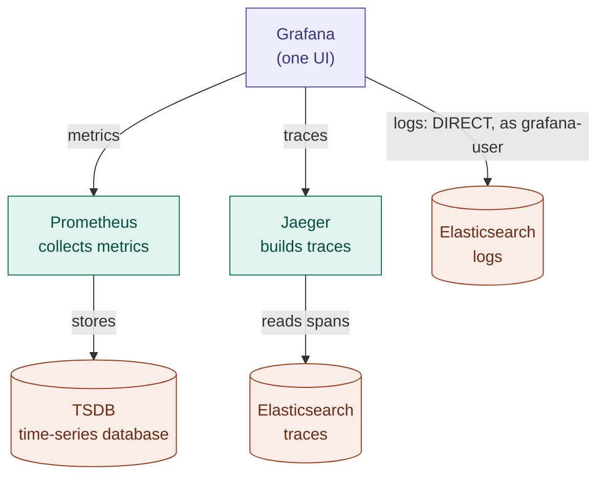

# Grafana for metrics, logs and traces: one UI

## In one minute

- **Grafana is the one UI** for all three signals: metrics, logs and traces.
- Grafana **only shows** data. It does not collect or store anything. Each signal still has its own backend and database.
- **Metrics:** Grafana asks **Prometheus**, which keeps them in its **TSDB** (time-series database).
- **Logs:** Grafana reads the **logs Elasticsearch directly**, as the read-only user `grafana-user`.
- **Traces:** Grafana asks **Jaeger**. Only Jaeger reads the **traces Elasticsearch**, then sends back the finished trace.
- The big win of one UI: from a spike on a graph, jump to that minute's logs and to the trace of a slow request, all on one screen.

---

## The three lanes



The cylinders are databases. Read it as three lanes:

| Lane | Path | Steps | Database |
|---|---|---|---|
| Metrics | Grafana → Prometheus | 1 | Prometheus TSDB |
| Logs | Grafana → Elasticsearch `logs` | 1, **direct** | Elasticsearch `logs` (namespace `logging`) |
| Traces | Grafana → Jaeger → Elasticsearch `traces` | 2 | Elasticsearch `traces` (namespace `tracing`) |

Grafana connects to **one** Elasticsearch, the logs one. It never talks to the traces Elasticsearch.

## Why traces go through Jaeger

A log line is stored as one complete document, so Grafana can search for it directly. A trace is stored as **many separate span documents** (`jaeger-span-*`). Turning them back into one trace means finding every span with the same `traceId`, putting each one under its `parentSpanId`, and sorting by time. That is Jaeger's job.

```
Grafana: "give me trace 4bf92f35..."
   └─► Jaeger: finds every span with that traceId in Elasticsearch traces,
               builds the tree (parent → child), sorts by time
   ◄── Jaeger: sends back the finished trace
Grafana: draws the waterfall
```

Think of a library: for a single book (a log) you go to the shelf yourself. For a set of scattered pages (spans) you ask the librarian (Jaeger), who knows how to collect and order them.

## Why Grafana instead of Kibana and the Jaeger UI

| Tool | What it was | Now |
|---|---|---|
| Kibana | a UI for the logs Elasticsearch | **removed**: Grafana shows the logs |
| Jaeger UI | a UI for traces, with no login | **kept private** (port-forward only): Grafana shows the traces |
| Jaeger itself | receives spans and builds traces | **still needed**: without it no traces arrive, and Grafana reads traces through it |
| Prometheus, Elasticsearch | the databases behind the data | **still needed**: Grafana stores nothing |

## The two Elasticsearch databases

ECK names everything after the Elasticsearch's `metadata.name`, in its own namespace:

| | Logs | Traces |
|---|---|---|
| Name | `logs` | `traces` |
| Namespace | `logging` | `tracing` |
| Address | `https://logs-es-http.logging.svc:9200` | `https://traces-es-http.tracing.svc:9200` |
| CA Secret | `logs-es-http-certs-public` | `traces-es-http-certs-public` |
| `elastic` password Secret | `logs-es-elastic-user` | `traces-es-elastic-user` |
| Used by | Fluent Bit (writes), Grafana (reads) | Jaeger |

## Who logs in as whom

Every tool has its own user with only the permissions it needs. Nothing uses the `elastic` superuser.

| Database | User | May | Used by |
|---|---|---|---|
| logs | `fluentbit-user` | write `logs-*` | Fluent Bit |
| logs | `grafana-user` | read `logs-*` | Grafana |
| traces | `jaeger-user` | use `jaeger-*` | Jaeger |
| both | `elastic` | everything | you only, for emergencies |

Grafana runs in namespace `monitoring` and cannot read Secrets in `logging`. So the logging module outputs `grafana-user`'s generated password, and the monitoring module copies it into the Secret `grafana-es-credentials`. Grafana reads it as `${ES_PASSWORD}`.

## Verifying the logs Elasticsearch certificate: trust-manager

The logs Elasticsearch's HTTPS certificate is signed by ECK's own CA. To check it, Grafana needs that CA's **public** certificate, which sits in `logs-es-http-certs-public` in namespace `logging`.

**trust-manager**, a small companion to cert-manager, copies only that public CA into namespace `monitoring`:

```
logs-es-http-certs-public (Secret, logging)
   └─ trust-manager Bundle "logs-es-ca"
        └─► ConfigMap logs-es-ca (monitoring)  →  Grafana env ES_CA  →  tlsCACert
```

- Only the public CA is copied, never a password. It is harmless to share.
- trust-manager reads its sources from one "trust namespace", here `logging`, which must exist before trust-manager is installed. That is why it is installed in the logging module.
- When the CA changes, trust-manager updates the copy automatically.

Grafana's Jaeger data source uses plain HTTP inside the cluster (`jaeger.tracing.svc:16686`), so it needs no CA.

## The data sources in Grafana

From [`k8s/observability/monitoring/helm-values.yaml`](../k8s/observability/monitoring/helm-values.yaml):

| Data source | `uid` | Talks to |
|---|---|---|
| Prometheus | built in | Prometheus |
| Elasticsearch logs | `elasticsearch-logs` | `https://logs-es-http.logging.svc:9200`, index `logs-*` |
| Jaeger | `jaeger` | `http://jaeger.tracing.svc.cluster.local:16686` |

Each `uid` is the data source's own ID. Inside the Jaeger data source, `tracesToLogsV2.datasourceUid: elasticsearch-logs` is not a second ID: it is a **link** to the logs data source. It powers the "Logs for this span" button, which opens the logs from one minute before to one minute after the span.

## How people reach it

```
https://grafana.jawsight.online   → Grafana (login: admin + generated password)
https://argocd.jawsight.online    → Argo CD
Private, port-forward only:  Jaeger UI, Prometheus UI, Alertmanager (they have no login)
```

In companies, daily dashboards get a URL with a company login (SSO), usually reachable only from the company network or VPN. Tools without a login stay private.

## Using it

```bash
# Grafana's admin password
kubectl get secret grafana-admin -n monitoring -o jsonpath="{.data.admin-password}" | base64 -d
```

In Grafana, open **Explore** and pick a data source:

- **Prometheus**: for example `rate(http_requests_total[5m])`
- **Elasticsearch logs**: query type **Logs**, for example `kubernetes.labels.app:backend`
- **Jaeger**: search service `todo-backend`, open a trace, then **Logs for this span**

## Limits

- "Logs for this span" matches logs by **time window**, not by trace ID. To match exactly, the backend would have to write the trace ID into each log line.
- Grafana uses its own admin login. The next step toward the industry setup is SSO, for example GitHub login.

## Sources

- [Grafana Elasticsearch data source](https://grafana.com/docs/grafana/latest/datasources/elasticsearch/)
- [Grafana Jaeger data source](https://grafana.com/docs/grafana/latest/datasources/jaeger/)
- [Grafana provisioning (environment variables)](https://grafana.com/docs/grafana/latest/administration/provisioning/)
- [trust-manager](https://cert-manager.io/docs/trust/trust-manager/)
- [ECK: TLS certificates](https://www.elastic.co/docs/deploy-manage/security/k8s-https-settings)
