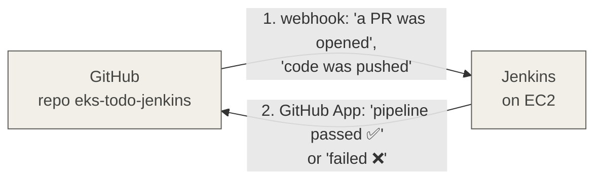
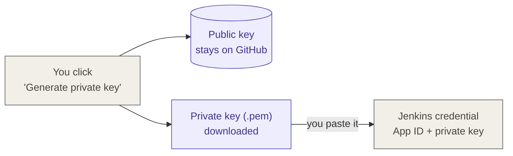
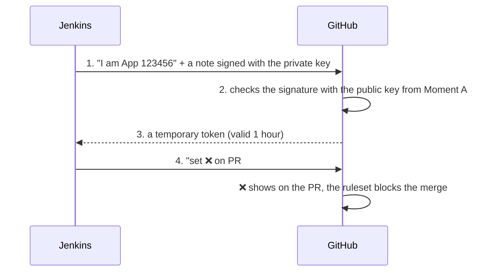
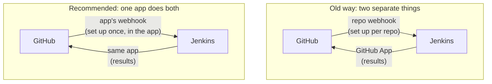

# Jenkins and GitHub: a GitHub App for PR checks and webhooks

## In one minute

- A GitHub **ruleset** can block a merge until some **required checks** are green. GitHub only knows about a check if someone **reports** it.
- SonarQube Cloud has its own GitHub App, so its check (**SonarCloud Code Analysis**) shows up. Jenkins reported nothing, so a failing gitleaks or Trivy stage never stopped a merge.
- The fix is to **create your own GitHub App** for Jenkins (there is no ready-made "Jenkins app" in the Marketplace), **install** it on the repo, and give Jenkins the app's **App ID** and **private key**.
- Messages go in **two directions**. The **webhook** sends events from GitHub to Jenkins, and the **app** lets Jenkins write ✅/❌ back to GitHub. The best practice is to let **one app do both**.
- Webhooks need a **stable address** for Jenkins (an Elastic IP, ideally with a domain name). The app connection does not, because Jenkins always calls GitHub, never the other way round.

---

## The problem we found

The ruleset on `main` listed two required checks:

| Required check | Who reports it | Worked? |
|---|---|---|
| SonarCloud Code Analysis | SonarQube Cloud's own GitHub App | ✅ yes |
| jenkins pipeline check | nobody (a made-up name) | ❌ no |

The PR pipeline ([`jenkins/Jenkinsfile.pr`](../jenkins/Jenkinsfile.pr)) runs gitleaks, Trivy, SonarCloud and the image builds. But if any stage failed, **GitHub never heard about it**, because Jenkins had no permission to write results to GitHub.

There was a second problem. A required check name must match a reported check **exactly**. "jenkins pipeline check" is never reported by anyone, so with it set every PR would wait forever.

---

## Two directions



| Direction | What it does | What it needs |
|---|---|---|
| **1. GitHub → Jenkins** | Starts a build when something happens | A **webhook**: GitHub calls a URL on Jenkins. No login needed, since GitHub is just sending a message to an address. |
| **2. Jenkins → GitHub** | Writes ✅/❌ on the PR | A **login with permission**, because GitHub doesn't let strangers write on your PRs. The **GitHub App** gives Jenkins that login. |

### How direction 1 already worked without any app

The repo has a **webhook** (repo → Settings → Webhooks) pointing at `http://<jenkins-ip>:8080/github-webhook/`. When something happens, GitHub sends a small message to that address. Anyone can receive a webhook, so no app was needed. That's why builds already started on their own.

---

## Create vs install

| Step | What it means | Done by |
|---|---|---|
| **Create** the app | The app exists: a name, permissions and keys. It can't touch any repo yet. | You, once |
| **Install** the app | You give the app access to the repos you choose | You, once (repos can be changed later) |

- There is **one app for the whole account**. You don't create one per repo.
- You choose the repos **during install**.

---

## Step 1: Create the app on GitHub

GitHub → your profile **Settings** → **Developer settings** → **GitHub Apps** → **New GitHub App**.

| Field | Value | Why |
|---|---|---|
| **GitHub App name** | e.g. `wicky-jenkins` | Any unique name |
| **Homepage URL** | `http://<jenkins-ip>:8080` | **Information only**, like a website link on a profile. GitHub never uses it to connect to Jenkins. |
| **Webhook → Active** | **unticked** for now (see [Using the app for both directions](#using-the-app-for-both-directions)) | The repo webhook already sends events. If both are on, every event arrives twice and starts duplicate builds. |
| **Where can this app be installed?** | **Only on this account** | Nobody else can install your app |

### Repository permissions

| Permission | Access | Why |
|---|---|---|
| **Checks** | Read and write | Jenkins **creates** the ✅/❌ check run |
| **Commit statuses** | Read and write | Jenkins **creates** the ✅/❌ status on the commit |
| **Contents** | Read-only | Jenkins reads the code. It can't change files or commits. |
| **Pull requests** | Read-only | Jenkins sees which PRs exist |
| **Metadata** | Read-only | Set for you |

**Why "Read and write" and not "Read only"?** These two permissions are **not about your code**. They only cover the small ✅/❌ results next to a commit or PR. Read only lets Jenkins **look** at existing results, such as Sonar's check. Jenkins's whole job here is to **create** its own result, and creating needs "write". Your code stays safe because **Contents** is read-only.

Click **Create GitHub App**.

### Write down the App ID and make the private key

1. On the app page, copy the **App ID** (a number).
2. Click **Generate a private key**. A `.pem` file downloads.

You do this **once, by hand**. GitHub keeps the matching **public key**, and you keep the **private key**. The private key is a secret: never put it in Git.

---

## Step 2: Install the app on the repo

1. On the app's settings page, click **Install App** in the left menu.
2. Click **Install** next to your account (`Wicky2001`).
3. Choose **Only select repositories**, then select **eks-todo-jenkins**.
4. Click **Install**.

To add or remove repos later, go to GitHub → **Settings** → **Applications** → **Installed GitHub Apps** → your app → **Configure** → **Repository access**. There's no need to reinstall.

### Which repos?

| Repo | Install? | Why |
|---|---|---|
| `eks-todo-jenkins` | ✅ yes | The PR pipeline runs here, so ✅/❌ goes here |
| `eks-todo-jenkins-gitops` | not needed now | Jenkins pushes there with a PAT (`github-eks-todo-jenkins-PAT`), and there is no PR pipeline on that repo |

**Only select repositories** follows **least privilege**: give access only where it's needed. If the private key ever leaks, only that one repo is at risk.

---

## Step 3: Give the key to Jenkins

1. The Jenkins plugin wants the key in **PKCS#8** format. Convert it on your computer:

   ```bash
   openssl pkcs8 -topk8 -inform PEM -outform PEM -in your-key.pem -out converted-key.pem -nocrypt
   ```

2. In **Manage Jenkins → Plugins**, check that these are installed: **GitHub Branch Source**, **Checks API** and **GitHub Checks**.
3. In **Manage Jenkins → Credentials → Add**:
   - **Kind:** GitHub App
   - **ID:** `github-app`
   - **App ID:** the number from Step 1
   - **Key:** the contents of `converted-key.pem`
   - Click **Test connection**. It should show your account.
4. Open the **PR checks** multibranch job → **Configure** → **Branch Sources** → GitHub → **Credentials** → pick `github-app` → **Save**.

---

## How Jenkins logs in with the app

Jenkins **always goes to GitHub**. GitHub never needs to find Jenkins for this. There are two moments.

### Moment A: setup (once, by you)



### Moment B: every build (automatic, by Jenkins)



The temporary token can only:
- work on the repos where the app is **installed**;
- do what you **ticked** in the permissions.

When it expires, Jenkins simply asks for a new one.

| Thing | Who makes it | How often |
|---|---|---|
| Private key + public key | **You** (click "Generate private key") | Once |
| Temporary token | **Jenkins**, automatically | Whenever it needs one (lasts 1 hour) |

Think of it as a staff ID card. The **App ID** is your name and the **private key** is your signature, which only you can make. GitHub checks the signature and gives you a **day pass** (the token) that opens only some doors (your repo, Checks and Statuses). Whoever has the private key can act as your app, so keep it secret.

---

## Step 4: Fix the ruleset

1. Open a test PR and let Jenkins run.
2. In the PR's **Checks** tab, a new Jenkins check appears, usually called **Jenkins** or `continuous-integration/jenkins/pr-merge`.
3. In the ruleset, **delete** "jenkins pipeline check".
4. Click **Add checks**, search for the real name from step 2, and set its source to **your app** (`wicky-jenkins`), not **Any source**. That way only your Jenkins can turn the check green.

GitHub only lets you pick a check name **after it has been reported at least once**. That's why the test PR comes first.

After this, the PR has two required checks:

| Required check | Reported by | Covers |
|---|---|---|
| SonarCloud Code Analysis | SonarQube Cloud app | Code quality gate |
| Jenkins | your app | The whole PR pipeline: gitleaks, Trivy, SonarCloud stage and image builds. If **any** stage fails, it is ❌. |

Required checks only protect **PRs**. The deploy pipeline runs after the merge to `main`, so it doesn't belong in the ruleset.

---

## The webhook section of the app form

The app form has its own **Webhook** section with **Active**, **Webhook URL** and **Secret**.

- A GitHub App can have **its own webhook**. It does the same job as the repo webhook: GitHub calls a URL when events happen.
- "Delivered when this hook is **triggered**" means **when an event happens**, such as a push or a new PR. **GitHub triggers it by itself**; nobody presses a button. You pick which events count in **Subscribe to events** further down the form.
- **Secret:** GitHub signs every message with it, so Jenkins can check that the message really came from GitHub.

---

## When the Jenkins IP changes

If the EC2 instance has no fixed IP, every stop and start gives it a new public IP.

| Thing | Breaks? | Fix |
|---|---|---|
| The GitHub App (Jenkins → GitHub) | ❌ no | Nothing. Jenkins calls GitHub, so GitHub never needs Jenkins's address. No reinstall, no new key. |
| The app's **Homepage URL** | ❌ no (information only) | Edit it on the app page if you like → **Save changes** |
| The **webhook** (GitHub → Jenkins) | ✅ **yes**: builds stop starting by themselves | Update the webhook URL to the new IP |
| **Jenkins URL** (Manage Jenkins → System) | ✅ yes: the "Details" link on the PR check goes nowhere | Change it to the new IP |
| The agent → controller connection | ❌ no | It uses `http://jenkins:8080` on the Docker network |

**The proper fix is an Elastic IP**, a fixed public IP that you attach to the instance: EC2 → **Elastic IPs → Allocate → Associate**. It stays the same after every stop and start.

**Cost:** AWS charges for **every** public IPv4 address, about $0.005 per hour. A normal auto-assigned IP costs the same while the instance runs, so an Elastic IP adds no extra cost then. It still costs a little **while the instance is stopped**, because AWS keeps the address for you.

**Industry practice:** an **Elastic IP plus a domain name**, e.g. `jenkins.yourdomain.com`, usually with HTTPS. If the server ever changes, you only update DNS, not GitHub.

---

## Using the app for both directions

### Old way vs recommended way



**Why teams prefer one app for both:**
- **One place to manage.** The URL, secret, permissions and events all live in the app.
- **New repos work automatically.** Install the app on a new repo and events start flowing. With repo webhooks, you add a webhook to every repo by hand.
- **Signed events.** The webhook **Secret** lets Jenkins reject fake messages.

Both ways still send events **to a URL on Jenkins**, so the app does **not** fix the changing-IP problem. You still need an Elastic IP or a domain name.

### How to switch

1. Attach an **Elastic IP** to the Jenkins EC2 instance.
2. Make a random secret on your computer:

   ```bash
   openssl rand -hex 32
   ```

3. Go to the app settings → **Webhook**:
   - tick **Active**;
   - **Webhook URL:** `http://<elastic-ip>:8080/github-webhook/`;
   - **Secret:** paste the value from step 2.
4. Same page → **Subscribe to events:** tick **Push** and **Pull request**. These boxes only show up once the matching permissions (Contents, Pull requests) are set.
5. In Jenkins, go to **Manage Jenkins → System → GitHub → Advanced → Shared secrets** and add the same secret as a **Secret text** credential. Jenkins then rejects unsigned messages.
6. **Delete the old repo webhook** (repo → Settings → Webhooks). If you keep both, every event arrives twice and starts duplicate builds.
7. Push a test commit and open a test PR, then check that both jobs start.

Nothing changes in the Jenkinsfiles. Both kinds of webhook arrive at the same `/github-webhook/` address, so the deploy job's `githubPush()` trigger and the multibranch PR job keep working.

---

## Interview answers

**"How does Jenkins report build results to GitHub?"**
> Through a GitHub App. Jenkins signs a short request with the app's private key, GitHub checks it with the public key and returns a one-hour installation token. Jenkins uses that token to create a check run on the commit. The token only works on the repos where the app is installed, and only with the permissions the app was given.

**"Why a GitHub App and not a personal access token?"**
> A PAT is tied to a person and usually has wide access that doesn't expire quickly. An app has its own identity, fine-grained permissions, access limited to chosen repos, and short-lived tokens. It also gets higher API rate limits.

**"Why does the PR merge get blocked when a Jenkins stage fails?"**
> The Jenkins check is a required status check in the branch ruleset. Any failed stage fails the pipeline, Jenkins reports ❌ through the app, and GitHub refuses the merge until the check is green.

**"What is the difference between a webhook and a GitHub App?"**
> A webhook is one-way: GitHub sends event messages to a URL. An app is an identity with permissions that can call the GitHub API. It can also have its own webhook, so one app can handle both directions.

**"What happens if the Jenkins server's IP changes?"**
> The app keeps working, because Jenkins calls GitHub. The webhook breaks, because GitHub calls Jenkins at the old address. That's why Jenkins needs a stable address: an Elastic IP, or better, a DNS name.
