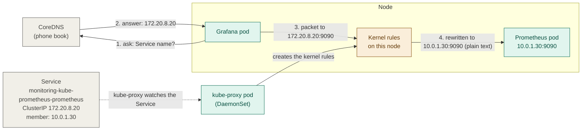
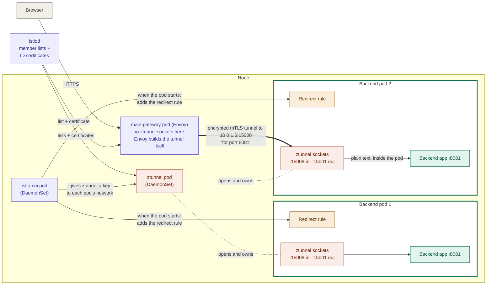
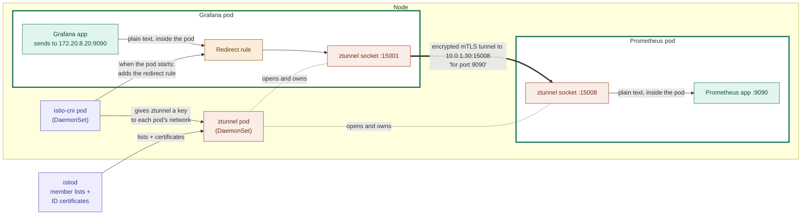

# Pod-to-pod traffic: Services, kube-proxy and Istio ztunnel

## In one minute

- Every pod has its own IP, but that IP changes when the pod restarts. So Kubernetes gives each group of pods a **Service**: a fixed name, a fixed IP (the **ClusterIP**) and a **member list** of pod IPs.
- A Service is **only a description**. It does not run anything, and nothing listens on the ClusterIP.
- There are **two ways** a request finds a pod through a Service:
  - **An ordinary pod calls the Service by name** (in this project: Grafana → Prometheus). **kube-proxy** watches the Service and creates **kernel rules** on every node. The kernel swaps the ClusterIP for one pod IP.
  - **A proxy reads the member list itself** (in this project: main-gateway → backend). Envoy picks a backend pod and goes **straight to its IP**. No ClusterIP, no kube-proxy.
- Without a mesh, both are **plain text**.
- **With Istio ambient mode**, **ztunnel** (one per node) puts **sockets inside every mesh pod**. Traffic between pods goes through an **encrypted mTLS tunnel**, and plain text exists only inside the sending pod and the receiving pod.

How the todo app is called: the **frontend pods only serve the web page files**. The **browser** calls `/api`, and that request goes **browser → main-gateway → backend**. No pod calls the backend by name.

---

## Part 1: without Istio's mesh

### What a Service is

| Part | Example (backend) | Who looks after it |
|---|---|---|
| Name | `backend-service` | You (YAML) |
| Fixed IP (**ClusterIP**) | for example `172.20.5.10` | Kubernetes picks it once and keeps it |
| Member list (**EndpointSlice**) | the IPs of the 2 backend pods | Kubernetes updates it whenever a backend pod starts or stops |

**Important:** the ClusterIP does not belong to any machine or pod. Nothing listens on it. It only exists as a **kernel rule** (see path A).

### Two helpers

| Helper | Kind | Job |
|---|---|---|
| **CoreDNS** | Deployment | The cluster's **phone book**: name → ClusterIP |
| **kube-proxy** | DaemonSet (one per node) | **Watches every Service** and **creates kernel rules** on its node: "a packet for this ClusterIP → change it to one of the member pod IPs" |

### Path A: an ordinary pod calls a Service by name (Grafana → Prometheus)

Grafana asks Prometheus for metrics at `monitoring-kube-prometheus-prometheus:9090`, which is a Service name. (The IPs in the picture are examples.)



**In the background, always:** kube-proxy watches the Service and its member list, and keeps the kernel rules up to date.

**One request:**

1. Grafana asks CoreDNS: "What is the IP of `monitoring-kube-prometheus-prometheus`?" The answer is the ClusterIP, `172.20.8.20`.
2. Grafana sends a packet to `172.20.8.20:9090`. As far as it knows, that is "Prometheus".
3. Before the packet leaves the Grafana pod's node, the Linux kernel checks its rules. It finds the rule for `172.20.8.20:9090` and **changes the destination** to a member pod, `10.0.1.30:9090`. If there were several members, the kernel would pick one at random. **That is the load balancing.**
4. The packet reaches the Prometheus pod as **plain text**. The reply comes back the same way. The kernel remembers the swap and changes the address back, so Grafana thinks the reply came from the ClusterIP.

### Path B: the gateway reads the member list itself (main-gateway → backend)

This is the real path of every `/api` request in the todo app.

```
Browser ──HTTPS──► main-gateway pod (Envoy) ──plain HTTP straight to a pod IP──► backend pod 1 or 2
                    (picks the pod itself from the member list istiod sent it)
```

**One request:**

1. The browser sends HTTPS to `todo.jawsight.online/api/todos`. The NLB passes it to a main-gateway pod.
2. Envoy decrypts the HTTPS and reads the HTTPRoute: `/api` → `backend-service:8081`.
3. Envoy already has the member list of `backend-service` (istiod sent it). It **picks one backend pod itself**, for example the one with the fewest requests in progress. **That is the load balancing.**
4. Envoy sends the request **straight to the pod IP**, `10.0.1.6:8081`. No CoreDNS, no ClusterIP, no kube-proxy. Today this hop is **plain HTTP**.

ingress-nginx worked the same way. Proxies at the front door go straight to pod IPs.

---

## Part 2: with Istio ambient mode (ztunnel)

### The new pieces

| Piece | Kind | Job |
|---|---|---|
| **istiod** | Deployment | The brain. Watches every Service, sends the member lists to every ztunnel and Envoy, and gives every pod an **ID certificate** (for example "I am backend"). |
| **istio-cni** | DaemonSet (one per node) | The installer. When a pod starts in a mesh namespace, it puts a **redirect rule inside that pod's network**. |
| **ztunnel** | DaemonSet (one per node) | The proxy. Opens **sockets inside every mesh pod on its node**, picks the destination pod, and encrypts and decrypts. |

A namespace joins the mesh with one label: `istio.io/dataplane-mode=ambient`. The pods are **not changed or restarted**.

### Where the sockets live

ztunnel is **one pod per node**, but it does not wait for traffic in its own pod. istio-cni hands it a key to each mesh pod's network, and ztunnel opens two sockets **inside every mesh pod**. A mesh pod is a pod in a namespace with the ambient label: `app`, `argocd`, `monitoring`. **The main-gateway pod is not one of them**, so it has no ztunnel sockets: its Envoy builds the encrypted tunnel itself.

| Socket | Inside | Used for |
|---|---|---|
| `:15001` | every mesh pod | traffic **going out** of the pod (the redirect rule sends it here) |
| `:15008` | every mesh pod | encrypted tunnels **coming in** to the pod |

A socket is like a **mailbox**: the place where a program waits for connections. Here the mailbox sits **inside your pod**, but **ztunnel** empties it.

### Path B with the mesh: main-gateway → backend

The gateway is built to **speak the encrypted tunnel (HBONE) itself**, so it needs no redirect rule. Only the receiving pod uses ztunnel.



**Once, when each backend pod starts:**

- **istio-cni** adds the redirect rule inside the pod's network, and gives ztunnel a key to that network.
- **ztunnel** uses the key to open its sockets (`:15008`, `:15001`) **inside the backend pod**.

**One request:**

1. The browser sends HTTPS. Envoy in the main-gateway pod decrypts it and reads the HTTPRoute: `/api` → `backend-service`.
2. Envoy **picks backend pod 2** from the member list (same as without the mesh).
3. **New:** Envoy opens an **encrypted mTLS tunnel** to `10.0.1.6`, port **15008**, using the **gateway's own ID certificate**. Inside the tunnel it writes "this is for port **8081**".
4. The ztunnel socket inside backend pod 2 checks the certificate ("is this really main-gateway?"), decrypts the data, sees "port 8081", and gives plain text to the backend app on **8081**, inside the pod.

Backend pod 1 has its own sockets too. Every mesh pod does, even when it is not picked.

### Path A with the mesh: Grafana → Prometheus

Grafana is an ordinary app, so here the **redirect rule** does the catching.



**Once, when each pod starts:**

- **istio-cni** adds the redirect rule inside the Grafana pod and the Prometheus pod, and gives ztunnel a key to each pod's network.
- **ztunnel** uses the keys to open its sockets inside both pods.

**One request:**

1. Grafana asks CoreDNS and gets the ClusterIP `172.20.8.20` (same as before).
2. Grafana sends to `172.20.8.20:9090` (same as before).
3. **New:** the redirect rule **inside the Grafana pod** catches the packet **before** it reaches the node's kube-proxy rules, and hands it to ztunnel's socket `:15001`, also inside the Grafana pod.
4. ztunnel reads the original destination, `172.20.8.20:9090`, and looks it up in **its own copy of the list** (from istiod): "that is the Prometheus Service, member `10.0.1.30`." **ztunnel picks the pod itself.** kube-proxy's rules are never used.
5. ztunnel opens an **encrypted mTLS tunnel** to `10.0.1.30:15008` with **Grafana's ID certificate**, and writes "for port **9090**" inside.
6. The socket inside the Prometheus pod checks the certificate ("is this really Grafana?"), decrypts the data, and gives plain text to Prometheus on **9090**.

If the two pods were on **different nodes**, nothing changes for the apps: each node's ztunnel owns the sockets of the pods on that node, and the encrypted tunnel crosses the network between the nodes.

### Side by side

| | Without the mesh | With ztunnel (ambient) |
|---|---|---|
| Grafana → Prometheus: who catches the packet | The node kernel (rules from kube-proxy) | The redirect rule **inside the Grafana pod** → ztunnel's socket |
| Gateway → backend: who picks the pod | Envoy (member list from istiod) | Envoy (same) |
| Grafana → Prometheus: who picks the pod | The kernel | **ztunnel** (member list from istiod) |
| On the network | Plain text to `pod-ip:port` | **Encrypted** to `pod-ip:15008`, "for port X" inside |
| Where plain text exists | Everywhere on the path | **Only inside the sending pod and the receiving pod** |

**So ztunnel knows the pod the same way kube-proxy does:** both look at the Service and its member list. kube-proxy turns it into kernel rules. ztunnel gets it from istiod and **picks the pod itself**, so it can build an encrypted tunnel to that exact pod.

## Sidecar vs ambient: same idea, different worker

| | Sidecar | Ambient |
|---|---|---|
| Who catches the app's traffic | Redirect rule in the pod → **Envoy container in the pod** | Redirect rule in the pod → **ztunnel's socket in the pod** |
| Where plain text exists | Only inside the pod | Only inside the pod |
| Who encrypts | The pod's own Envoy | The node's ztunnel |
| Proxies | One per pod | One per node |

## Words to know

| Word | Meaning |
|---|---|
| **ClusterIP** | The fixed, made-up IP of a Service. Only exists as a kernel rule. |
| **EndpointSlice** | The Service's member list: the IPs of the ready pods. |
| **kube-proxy** | Watches Services and creates kernel rules, so the kernel can swap a ClusterIP for a pod IP. |
| **ztunnel** | Istio's per-node proxy in ambient mode (zero-trust tunnel). Does mTLS. |
| **istio-cni** | Sets up the redirect rule inside each mesh pod. |
| **HBONE** | The encrypted tunnel format used by ztunnel and Istio gateways (mTLS on port 15008). |
| **mTLS** | TLS where **both** sides show a certificate, so each knows who the other is. |
