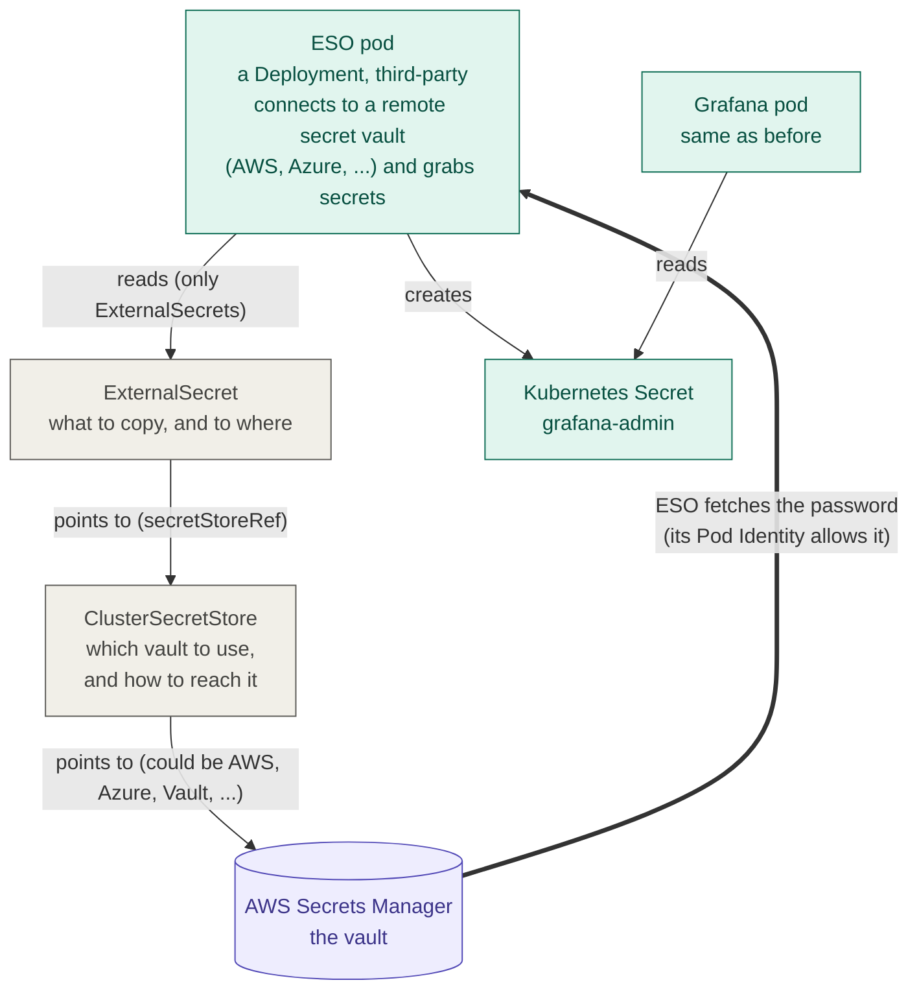

# Secrets with AWS Secrets Manager and ESO

## In one minute

- Passwords must never be in Git, but Argo CD only applies what is in Git.
- So the passwords live in **AWS Secrets Manager** (a vault in AWS), and **ESO** (External Secrets Operator) copies them into normal **Kubernetes Secrets** inside the cluster.
- Git only holds **ExternalSecret** files that say *what* to copy and *where*. They contain no passwords.
- The apps don't change: Grafana, Fluent Bit and Jaeger still read normal Kubernetes Secrets.

---

## The pieces

| Piece | What it is | Who creates it |
|---|---|---|
| **AWS Secrets Manager** | An AWS service that stores passwords safely: encrypted, every read is logged, passwords can be rotated | AWS (we just use it) |
| **The secrets in it** | `eks-todo/grafana-admin`, `eks-todo/fluentbit-user`, ... (each one is JSON) | Terraform ([`tf/infra/modules/secrets`](../tf/infra/modules/secrets/main.tf)) |
| **ESO** | A **third-party, open-source** tool (external-secrets.io), **not made by AWS**. It runs as small **Deployments** (no DaemonSet) in namespace `external-secrets`, connects to a remote vault (AWS Secrets Manager, Azure Key Vault, HashiCorp Vault, ...) and copies secrets from it | Terraform (Helm chart) |
| **IAM role** | Lets ESO read only the `eks-todo/*` secrets. Given to ESO's service account through **Pod Identity** | Terraform |
| **ClusterSecretStore** | One small file: *which* vault, and how to reach it (AWS Secrets Manager, region `us-east-1`). "Cluster" = ExternalSecrets in any namespace may use it | Terraform ([`k8s/external-secrets/cluster-secret-store.yaml`](../k8s/external-secrets/cluster-secret-store.yaml)) |
| **ExternalSecret** | One file per Kubernetes Secret: *what* to copy, and *to where* | Argo CD, from the GitOps repo (`platform/*/manifests/secrets/`) |

## Who reads what

ESO **only reads ExternalSecrets**. It never looks at a store, or at AWS, on its own. It follows the pointers:



1. ESO watches all ExternalSecrets. When one is created or changed it acts right away, and it checks again every `refreshInterval` (1 hour here).
2. The ExternalSecret's `secretStoreRef` names the ClusterSecretStore to use.
3. The ClusterSecretStore says which vault: AWS Secrets Manager, region `us-east-1`.
4. ESO asks AWS for the secret. Its pod has temporary AWS keys from Pod Identity, and the IAM role allows reading only `eks-todo/*`.
5. ESO creates (and keeps updating) the Kubernetes Secret.
6. The app reads that Secret, exactly as before.

## An ExternalSecret, field by field

```yaml
apiVersion: external-secrets.io/v1
kind: ExternalSecret
metadata:
  name: grafana-es-credentials        # (1)
  namespace: monitoring               # (2)
spec:
  refreshInterval: 1h                 # (3)
  secretStoreRef:                     # (4)
    kind: ClusterSecretStore
    name: aws-secrets-manager
  target:
    name: grafana-es-credentials      # (5)
  data:
    - secretKey: password             # (6)
      remoteRef:
        key: eks-todo/grafana-user    # (7)
        property: password            # (8)
```

| # | Field | Meaning |
|---|---|---|
| 1 | `metadata.name` | The name of this ExternalSecret file itself (usually the same as the Secret it makes) |
| 2 | `metadata.namespace` | Where this ExternalSecret lives. ESO creates the Secret **in the same namespace**, which matters because a pod can only read Secrets in its own namespace |
| 3 | `refreshInterval` | How often ESO checks AWS again |
| 4 | `secretStoreRef` | Which ClusterSecretStore (which vault) to use |
| 5 | `target.name` | The name of the Kubernetes Secret ESO creates |
| 6 | `secretKey` | The key name **inside** that Kubernetes Secret |
| 7 | `remoteRef.key` | The secret's name in AWS Secrets Manager |
| 8 | `remoteRef.property` | Which field of the AWS secret (it is JSON) |

### `secretKey` with an example

A Kubernetes Secret is a list of **key: value** pairs. ESO copies **AWS field → Kubernetes key**:

```
AWS Secrets Manager                       Kubernetes Secret (made by ESO)
eks-todo/grafana-user                     grafana-es-credentials   (target.name)
{                                         data:
  "username": "grafana-user",
  "password": "Xy7Kq...",   ──property──►   password: Xy7Kq...      (secretKey)
  "roles": "grafana_reader"
}
```

Grafana reads the key `password` (see `ES_PASSWORD` in `helm-values.yaml`), so `secretKey` must match what the app expects.

Most of our ExternalSecrets copy **every** field instead, with `dataFrom: extract`. Then each JSON field simply becomes a key of the same name.

## Pod Identity and the service account

The same service account name must appear in two places, like the AWS Load Balancer Controller:

| Where | What |
|---|---|
| ESO's Helm values ([`tf/infra/modules/secrets`](../tf/infra/modules/secrets/main.tf)) | `serviceAccount.name: external-secrets`, so the ESO pod runs as that service account in namespace `external-secrets` |
| The Pod Identity association (same file) | `namespace = "external-secrets"`, `service_account = "external-secrets"`, plus the IAM role that may read `eks-todo/*` |

The ClusterSecretStore does not mention the service account. ESO simply uses its own pod's AWS keys.

## The secrets in this project

| AWS Secrets Manager | Kubernetes Secret | Namespace | Used by | ExternalSecret file (GitOps repo) |
|---|---|---|---|---|
| `eks-todo/grafana-admin` | `grafana-admin` | monitoring | Grafana admin login | `platform/monitoring/manifests/secrets/grafana-admin.yaml` |
| `eks-todo/grafana-github-oauth` | `grafana-github-oauth` | monitoring | Grafana "Log in with GitHub" | `platform/monitoring/manifests/secrets/grafana-github-oauth.yaml` |
| `eks-todo/mail-pass` | `mail-pass` | monitoring | Alertmanager alert emails | `platform/monitoring/manifests/secrets/mail-pass.yaml` |
| `eks-todo/grafana-user` | `grafana-es-credentials` (only `password`) | monitoring | Grafana reading logs | `platform/monitoring/manifests/secrets/grafana-es-credentials.yaml` |
| `eks-todo/grafana-user` | `grafana-user` | logging | ECK creates the Elasticsearch user | `platform/logging/manifests/secrets/grafana-user.yaml` |
| `eks-todo/fluentbit-user` | `fluentbit-user` | logging | ECK creates the user, Fluent Bit logs in | `platform/logging/manifests/secrets/fluentbit-user.yaml` |
| `eks-todo/jaeger-user` | `jaeger-user` | tracing | ECK creates the user, Jaeger logs in | `platform/tracing/manifests/secrets/jaeger-user.yaml` |

The Elasticsearch **role** Secrets (`fluentbit-role`, `grafana-role`, `jaeger-role`) are plain Secret files in Git: they only list what each user may do, with no password.

The ECK user Secrets need the type `kubernetes.io/basic-auth`, so their ExternalSecrets set `target.template.type` and `mergePolicy: Merge`. Without `Merge`, the template would replace (drop) the fetched fields.

## Good to know

- **Cost:** about $0.40 per secret per month (6 secrets, about $2.40 a month).
- **Destroy:** the secrets use `recovery_window_in_days = 0`, so `terraform destroy` deletes them right away. The default keeps them 7-30 days, and a secret with the same name could not be created again until then.
- **Change a password:** change it in AWS Secrets Manager. ESO updates the Kubernetes Secret within an hour. Apps that read it only at start (most do) need a restart.
- **The other tool:** the Secrets Store CSI Driver (with the AWS provider) does a similar job. It **is** a DaemonSet and puts secrets into pods as files. ESO is the more common choice with GitOps because apps keep using normal Kubernetes Secrets.
