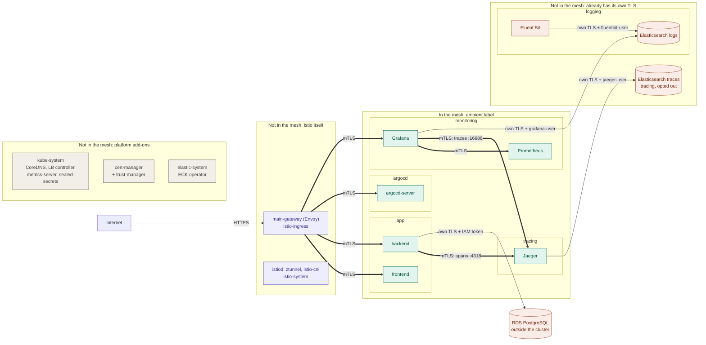

# What is inside the mesh, and why

## In one minute

- The mesh (Istio ambient mode) encrypts traffic between pods **with mTLS**, and gives every pod an ID, so each side knows who it is talking to.
- A namespace joins with one label: `istio.io/dataplane-mode=ambient`. One pod can opt out with `istio.io/dataplane-mode=none`.
- **Rule of thumb:** put a workload in the mesh when it **sends or receives plain HTTP** between pods. Leave it out when its traffic **is already encrypted with its own TLS**, or when it **is part of the platform itself** (Istio, DNS, controllers).
- **In the mesh:** `app`, `argocd`, `monitoring`, `tracing` (Jaeger).
- **Not in the mesh:** `logging` (Elasticsearch `logs` + Fluent Bit), the Elasticsearch `traces` pod, `istio-system`, `istio-ingress`, `kube-system`, `cert-manager`, `elastic-system`.

---

## The picture



- **Thick arrows** = encrypted by the mesh (mTLS).
- **Thin arrows** = encrypted by the app itself (its own TLS, with its own user and password or token).
- **No arrow is plain text** once the mesh is on.

---

## Why each one is in or out

### In the mesh

| Namespace | Plain-text traffic it had | What the mesh adds |
|---|---|---|
| `app` | gateway → frontend, gateway → backend, backend → Jaeger | mTLS on every hop, and IDs ("this really is main-gateway") |
| `argocd` | gateway → argocd-server (Argo CD serves plain HTTP behind the gateway) | mTLS on that hop, plus between the Argo CD parts (server, repo-server, controller, Redis) |
| `monitoring` | gateway → Grafana, Grafana → Prometheus, Grafana → Jaeger | mTLS on every hop |
| `tracing` (Jaeger only) | backend → Jaeger `:4318`, Grafana → Jaeger `:16686` | mTLS on both hops. Jaeger's own ports have no TLS, so the mesh is the easiest way to encrypt them. |

### Not in the mesh: already has its own TLS

| What | Why not |
|---|---|
| `logging`: Elasticsearch `logs` + Fluent Bit | Every connection to this Elasticsearch is **already HTTPS**: Fluent Bit and Grafana check its certificate and log in with their own user. The mesh would only encrypt it **a second time**, which costs CPU for no gain. Fluent Bit reads log **files on the node**, which is not network traffic at all. |
| Elasticsearch `traces` pod | Same reason: Jaeger already talks to it over HTTPS with `jaeger-user`. It lives in `tracing` (which joins the mesh), so it opts out with the pod label `istio.io/dataplane-mode=none`. |
| RDS (outside the cluster) | The mesh only covers pods. The backend already connects with TLS and an IAM token. |

### Not in the mesh: platform add-ons

| What | Why not |
|---|---|
| `istio-system` (istiod, ztunnel, istio-cni) | They **are** the mesh. The mesh can't depend on itself to start. |
| `istio-ingress` (main-gateway) | Its Envoy **already speaks mTLS** to mesh pods by itself. It needs no ztunnel. |
| `kube-system` (CoreDNS, LB controller, metrics-server, sealed-secrets) | Core cluster parts that everything, including Istio, needs in order to start. They mostly talk to the Kubernetes API server or AWS, which is already HTTPS. istio-cni even skips `kube-system` by default (`excludeNamespaces: [kube-system]` in its Helm chart). |
| `cert-manager` (+ trust-manager) | Talks to the API server and to Let's Encrypt, which is already HTTPS. |
| `elastic-system` (ECK operator) | Talks to the API server, and to Elasticsearch over HTTPS. |

---

## Questions people ask

**Does Fluent Bit use TLS to Elasticsearch?**
Yes. `tls On`, `tls.verify On`, the Elasticsearch CA from `logs-es-http-certs-public`, and its own user `fluentbit-user` (see `k8s/observability/logging/fluent-bit-values.yaml`).

**Does Jaeger use TLS to Elasticsearch?**
Yes. `https://traces-es-http.tracing.svc:9200` with the CA file and `jaeger-user` (see `k8s/observability/tracing/jaeger-values.yaml`).

**Then why does `tracing` join the mesh?**
Because Jaeger's **own** ports are plain HTTP: the backend sends spans to `http://jaeger...:4318`, and Grafana reads traces from `http://jaeger...:16686`. Only the Jaeger → Elasticsearch hop had TLS.

**What about Kibana?**
Kibana was removed. Grafana is the one UI for metrics, logs and traces. (For the record: with ECK, Kibana also talks to Elasticsearch over HTTPS, set up automatically.)

**When I use `kubectl port-forward`, is that encrypted?**
Yes, without the mesh:

```
Laptop ──TLS──► Kubernetes API server ──TLS──► kubelet on the node ──► the pod (inside the node)
```

Port-forward does not use the pod network at all, so the mesh is not involved. You also need Kubernetes permission (your kubeconfig) to use it.

**Is double encryption (own TLS inside mTLS) wrong?**
It works. It just costs CPU for no extra safety, so we avoid it where the app already does TLS well.

**What does the mesh give besides encryption?**
Identity: each side knows **which workload** is calling, for example "main-gateway" or "grafana". Later you can write rules such as "only main-gateway may call the backend" (Istio `AuthorizationPolicy`).

---

## Interview answer

> "I enrolled the namespaces that had plain-text service-to-service traffic: the app, Argo CD, monitoring and Jaeger. Components that already do end-to-end TLS with their own users, like the Elasticsearch clusters, stay out to avoid double encryption. The Elasticsearch pod inside the tracing namespace opts out with a pod label. Platform components (Istio itself, kube-system, cert-manager and operators) stay out, because the mesh depends on them and they mostly talk to the API server over TLS. The ingress gateway isn't enrolled either, because it speaks mTLS to the mesh natively."
